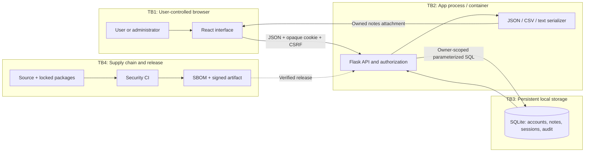

# Team Outsiders - NoteVault threat model

Team marker: `3d821afbe8a0`. Application edition: Fieldnotes.

Assets: private notes, account password hashes, session tokens, team identity, audit history, source code, dependency inventory and release integrity. Attackers: unauthenticated registrants, malicious authenticated users, compromised dependencies, and a local privileged operator. Real university systems, real credentials and other teams’ databases are out of scope.

## Data-flow diagram

HTTP is loopback-only for this lab. A future non-local deployment must add HTTPS. The runtime contains only the hardened application; the original vulnerable app is accessed by an isolated test client.

## STRIDE

| Element or flow | STRIDE risks | Mitigation and residual risk |
|---|---|---|
| Browser to API | Spoofing, tampering, information disclosure, elevation | Opaque sessions, JSON + CSRF, owner predicates, escaping and CSP. HTTPS is required outside loopback. |
| Registration/login | Spoofing, denial of service, elevation | Server-selected role, scrypt, generic errors, persistent IP throttle. No MFA or recovery flow. |
| Notes API to SQLite | Tampering, information disclosure, elevation | Parameters, owner IDs, foreign keys, versions and input limits. A host/database operator can still read data. |
| Export to browser | Tampering, information disclosure | Owner-scoped serialization, format allowlist, attachment download and CSV formula protection. Downloaded files become the user’s responsibility. |
| Audit history | Repudiation, tampering | Record actor, action, object and timestamp. Local logs are not immutable or externally monitored. |
| Dependencies/build/release | Tampering, elevation, information disclosure | Lockfiles with hashes, pinned base images/actions, scan gates, SBOM and signatures. Trust still includes registries, build tools and signing-key custody. |

## Top risks

| Rank | Threat | Likelihood x impact (1-5) | Before / mitigation |
|---|---|---|---|
| 1 | F-05 shell execution | 5 x 5 = 25 | Arbitrary commands; remove the shell completely. |
| 2 | F-07 session forgery | 5 x 5 = 25 | Impersonation; random, expiring, revocable server sessions. |
| 3 | F-01 injection | 5 x 4 = 20 | Query manipulation; bind all user values. |
| 4 | F-02/F-03 authorization | 5 x 4 = 20 | Cross-user data and roles; server-side authorization. |
| 5 | F-04 interpreted stored content | 4 x 5 = 20 | HTML/template injection; typed JSON and text rendering. |

These qualitative scores prioritize remediation; they are not calculated CVSS scores or a guarantee of residual safety.
